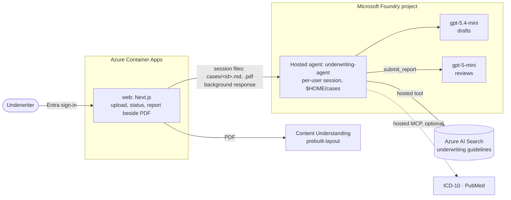

# Medical underwriting copilot

This template turns a scanned medical record into a drafted underwriting report
that a human underwriter reviews beside the original document. Every stated fact
cites the page it came from. It drafts; it does not decide.

An underwriter uploads a PDF. Content Understanding reads it and flags numbers it
read with low confidence. A Foundry Hosted Agent reads the record, searches the
underwriting guidelines in Azure AI Search, optionally checks codes and findings
with ICD-10 and PubMed MCP servers, and submits a structured report. **A second,
different model reviews the draft against the record** before it is released;
a failing draft gets one revision, and a draft that still fails is released with
the failed review attached instead of looping.

**All data in this template is synthetic**: the sample records, the patients,
the clinics, and the underwriting guidelines are fictional and illustrative.
They are not actuarial guidance.

## What this template is for

- Learn how a Hosted Agent can produce a structured, source-cited document from a
  long, OCR'd record instead of a chat answer.
- See native Foundry primitives doing the plumbing: per-user agent sessions and
  session files for documents, background responses for long runs, skills for
  long formatting rules, hosted Azure AI Search and MCP tools.
- Add a second-model review step that blocks unsupported facts.
- Provide a starting point for document-review copilots in regulated work.

## What this template is not for

This template is not a production underwriting system and makes no
underwriting decisions. It does not provide private networking, document-level
retention policies, audit logging beyond the Foundry project's tracing, data
residency controls, multi-document cases, case lists, or human sign-off
workflow. The ICD-10 and PubMed MCP servers are public third-party endpoints:
set `MEDICAL_MCP_ENABLED=false` before using real records. Do not upload real
medical records to a deployment you have not reviewed for your organization's
privacy and compliance requirements.

Review [Cost planning](docs/cost.md) before provisioning: Azure AI Search Basic
is an always-on cost of about USD 74 a month.

## Architecture



| Component | Folder | What it does |
|---|---|---|
| Hosted agent | `src/agent` | Agent Framework agent (Responses protocol): a paged record reader, the hosted guidelines search and MCP tools, two skills, and `submit_report`, which runs the second-model review. |
| Web app | `src/web` | Next.js. Runs OCR, writes the case into the user's agent session, starts a background run, polls it, and shows the report with page citations beside the PDF. |
| Guidelines | `data/guidelines` | Synthetic guideline passages, seeded into Azure AI Search by `scripts/seed_guidelines.py` after provisioning. |
| Sample records | `data/sample-records` | Three synthetic PDFs and the script that generates them. |
| Infrastructure | `infra-foundry`, `infra` | The `microsoft.foundry` layer creates the Foundry account, project, and both models. A Bicep layer adds Azure AI Search, the project connection, Container Apps, a registry, a managed identity, RBAC, and Entra sign-in with no client secret. |

See [Architecture](docs/architecture.md) for the request flow and the security model.

## Deploy

Required tools: Azure CLI, Azure Developer CLI (`azd`) 1.32 or later, and Python 3
on the `PATH` (for the post-provision hook). The deploying identity needs:

- **Owner**, or **Contributor** and **User Access Administrator**, on the subscription;
- permission to create Microsoft Entra app registrations;
- quota for 30K TPM each of `gpt-5.4-mini` and `gpt-5-mini` GlobalStandard.

If Azure AI Search has no capacity in your region (`InsufficientResourcesAvailable`),
run `azd env set AZURE_SEARCH_LOCATION <other-region>` and `azd up` again.

Choose a region that supports Foundry Hosted Agents, Content Understanding, and
both models.

```bash
azd extension install azure.ai.agents
azd extension install azure.ai.projects
az login
azd auth login
azd env new <environment-name> --subscription <subscription-id> --location <region>
azd up
```

`azd up` provisions both layers, seeds the guidelines index, deploys the hosted
agent and the web app, and prints `WEB_URL`. If the hook reports that
`AZURE_PRINCIPAL_ID` is missing, run
`azd env set AZURE_PRINCIPAL_ID $(az ad signed-in-user show --query id -o tsv)` and
`azd provision` again.

## Try it

1. Open `WEB_URL`, sign in, and upload `data/sample-records/sample-02-diabetes.pdf`.
2. Wait two to three minutes. The page shows the run's status; individual tool
   steps are not visible until the report is ready.
3. Read the report. Select a `p.N` citation to show that page of the PDF.
4. Expect the pending urine test to read **Not interpreted** and the
   recommendation to be **Postpone**, citing the pending-investigation guideline.
5. Open **OCR source** to see the extracted text and any low-confidence numbers.

## Customize

- **Guidelines:** replace `data/guidelines/*.md` (one `## ` section per passage)
  and run `python scripts/seed_guidelines.py` with `SEARCH_ENDPOINT` and
  `SEARCH_INDEX_NAME` set.
- **Report format and decision policy:** edit the skills in `src/agent/skills`.
  They load on demand, so a longer policy does not cost tokens on every turn.
- **Report fields:** edit the Pydantic models in `src/agent/report.py` and the
  matching types in `src/web/src/app/report.tsx`.
- **Models:** change the deployments in `azure.yaml` and set
  `AZURE_AI_MODEL_DEPLOYMENT_NAME` / `JUDGE_MODEL_DEPLOYMENT_NAME`. Keep the
  reviewer a different model from the drafter.

## Clean up

```bash
azd down --purge
az ad app delete --id $(azd env get-value WEB_APP_REGISTRATION_CLIENT_ID)
```

## Validation status

Validated live on 2026-11-15 (East US 2; Search in West US 2), then torn down:

- **Sample 02, in a browser:** upload to report in 158 seconds.
  - The recommendation was **Postpone** for the pending urine test, and the
    pending result reads "Not interpreted".
  - 18 page citations rendered, and the second-model review passed after one
    revision.
  - The OCR tab listed 8 low-confidence values.
- **Sample 01, through the deployed web app's own managed identity:** **Rated**
  in 111 seconds, and the review passed first time.
- **Isolation:** a second user gets 404 for the first user's case and PDF.
- **Sign-in:** the public endpoint returns 401 without sign-in, including when a
  spoofed principal header is sent.

See [Architecture](docs/architecture.md#live-validation-findings) for what the
live run changed.
