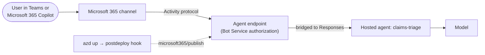

# Teams and Microsoft 365 Copilot client for a Foundry Hosted Agent

This template deploys a Microsoft Foundry hosted agent and publishes it to
**Microsoft Teams** and **Microsoft 365 Copilot** with one `azd up`. It uses
Foundry's built-in publishing: Foundry registers the agent with Teams, builds
the Teams app package, and lists the agent in the agent store. There is no Azure
Bot Service resource, gateway, or hand-written Teams manifest.

The agent is the same claims-triage agent as the
[AG-UI web client template](../ag-ui-hosted-agent/): one agent, reached from a
browser there and from Teams here. It lists flagged insurance claims, looks up a
claim, and escalates a claim to investigators. The data is synthetic.

## What this template is for

- Learn the current, native way to put a Foundry hosted agent in Teams and
  Microsoft 365 Copilot.
- Deploy and publish a working agent in one command, and update it with
  `azd deploy` without republishing.
- Script the publish step, including the package download for review or manual
  upload.
- Provide a starting point for your own agent in Teams.

## What this template is not for

This template is not a production-ready or multitenant application. It does not
deploy private networking (see
[Private-network Hosted Agent](https://github.com/microsoft/Foundry-Agent-Solution-Templates/tree/main/private-network-hosted-agent)
and Microsoft's [REST publishing guide](https://learn.microsoft.com/azure/foundry/agents/how-to/publish-copilot-virtual-network)
for that case), route traffic through API Management, build Adaptive Cards or a
custom Teams manifest, publish as a Microsoft Agent 365 autopilot, or support
guest users. Published agents don't stream and don't show citations. It provides
no centralized monitoring, backup, or support SLA.

Review [Cost planning](docs/cost.md) before provisioning.

## Architecture



| Component | Folder | What it does |
|---|---|---|
| Hosted agent | `src/agent` | Agent Framework agent with `list_flagged_claims`, `lookup_claim`, and the approval-gated `escalate_claim`. Speaks the Responses protocol; Foundry bridges it to Teams. |
| Publish step | `scripts/publish_m365.py` | Calls Foundry's Microsoft 365 publish API after each deploy. Standard library only. |
| Infrastructure | `infra-foundry` | The `microsoft.foundry` layer: Foundry account, project, and model. Nothing else. |

See [Architecture](docs/architecture.md) for the request flow, the access
model, and why this differs from hand-built Bot Service designs.

## Deploy

Required tools: Azure CLI, Azure Developer CLI (`azd`) 1.32 or later, and
Python 3 (for the publish step).

You need:

- **Owner**, or **Contributor** and **User Access Administrator**, on the
  subscription;
- **Foundry User** on the project for you and for everyone who chats with the
  agent under the default `Shared` scope (`BotServiceRbac`). The template does
  not grant it. Owner alone is not enough, because it has no data actions:

  ```bash
  az role assignment create --role "Foundry User" --assignee <user@contoso.com> \
    --scope "$(az cognitiveservices account show -g "$(azd env get-value AZURE_FOUNDRY_RESOURCE_GROUP)" \
    -n "$(azd env get-value AZURE_AI_ACCOUNT_NAME)" --query id -o tsv)/projects/$(azd env get-value AZURE_AI_PROJECT_NAME)"
  ```

- an Azure subscription in the **same Microsoft Entra tenant** as your
  Microsoft 365 organization;
- quota for 10K TPM of `gpt-5.4-mini` GlobalStandard;
- to sign in to `az` **as a user**, not a service principal: Foundry's publish API
  acts on behalf of the signed-in user.

```bash
azd extension install azure.ai.agents
azd extension install azure.ai.projects
az login
azd auth login
azd env new <environment-name> --subscription <subscription-id> --location <region>
azd up
```

`azd up` deploys the agent and publishes it with `Shared` scope: only you see it
at first, and no admin approval is needed. azd doesn't print the publish step's
output; run `python scripts/publish_m365.py` from this folder to see it (it is
safe to rerun). To share the agent with colleagues, grant them Foundry User as
above and send them the agent link from **Your agents**.

Publishing settings (set with `azd env set` before `azd up`, or rerun
`python scripts/publish_m365.py` from this folder after changing them):

| Setting | Default | Meaning |
|---|---|---|
| `TEAMS_PUBLISH` | `true` | `false` deploys the agent without publishing it. |
| `TEAMS_PUBLISH_SCOPE` | `Shared` | `Tenant` lists it for your whole organization after admin approval. |
| `TEAMS_APP_VERSION` | `1.0.0` | Increase it to change the name or descriptions shown in Teams. |

### Organization-wide (admin step)

1. `azd env set TEAMS_PUBLISH_SCOPE Tenant`, `azd env set TEAMS_APP_VERSION 1.0.1`,
   then `python scripts/publish_m365.py`.
2. **Microsoft 365 admin:** approve the request in the
   [Microsoft 365 admin center](https://admin.cloud.microsoft/?#/agents/all/requested).
3. The agent appears under **Built by your org** for everyone in the tenant.

## Try it

**In Microsoft Teams:** open **Apps** (or the **Copilot** app) and find
**Claims Triage** under **Agents → Your agents**. The store refreshes about
hourly; sign out and back in if it isn't there yet. Then:

1. "Which claims are flagged?" The agent lists CLM-1002, CLM-1004, and CLM-1006.
2. "Look up CLM-1004." It returns that claim's record.
3. "Escalate CLM-1006 because the receipts are outside the trip." See
   [Validation status](#validation-status) for how approval behaves in Teams.
4. Send `/foundry_new_preview` to start a new conversation.

**In Microsoft 365 Copilot:** open [Microsoft 365 Copilot](https://m365.cloud.microsoft/chat),
select **Agents → Your agents → Claims Triage**, and ask the same questions.

## Customize

- **Your own agent:** replace `src/agent` and set `AGENT_NAME` in
  `scripts/publish_m365.py` to the agent name in `azure.yaml`.
- **Store listing:** edit `publish_body()` in `scripts/publish_m365.py`. Keep the
  developer name to 32 characters and URLs on `https://`.
- **Review the Teams package:** `python scripts/publish_m365.py --download` saves
  `appPackage.zip` without publishing.

## Clean up

1. Remove the agent from Teams: **Apps → Manage your apps → Claims Triage →
   Remove**. For `Tenant` scope, a Microsoft 365 admin removes it in the admin
   center.
2. Delete the Azure resources:

   ```bash
   azd down --purge --force
   ```

3. Remove the agent's identity. Deleting the agent does not delete it (verified
   live on 2026-11-15).

   `azd down` doesn't remove the Microsoft Entra agent identities that Foundry creates for agents
   (display names end in `AgentIdentity`, tagged with the project name). After the resource group is
   gone, list and delete the ones for this project (from a bash shell):

   ```bash
   PROJECT=$(azd env get-value AZURE_AI_PROJECT_NAME)
   az rest --method get --headers ConsistencyLevel=eventual \
     --url "https://graph.microsoft.com/beta/servicePrincipals?\$filter=endswith(displayName,'AgentIdentity')&\$count=true&\$select=id,displayName,tags&\$top=200" \
     --query "value[?contains(tags, 'projectName:$PROJECT')].[id, displayName]" -o tsv
   az rest --method delete --url "https://graph.microsoft.com/beta/servicePrincipals/<id>"   # for each id listed
   ```

## Validation status

Deployed live on 2026-11-15 (East US 2; azd 1.37.3, `azure.ai.projects` 1.1.0,
`azure.ai.agents` 1.1.0). The test used `gpt-5-mini` because the subscription had
no `gpt-5.4-mini` quota.

- **Agent:** `azd ai agent invoke` returned the three flagged claims (CLM-1002,
  CLM-1004, CLM-1006) through the `list_flagged_claims` tool.
- **Publish:** the `postdeploy` hook ran on `azd deploy` and the publish API
  returned a Teams app ID with `Shared` scope. Republishing the same version
  succeeds; Foundry increments the package version itself.
- **Channel registration:** the generated package's bot ID is the agent's own
  Entra identity (`<account>-<project>-claims-triage-AgentIdentity`), enabled for
  personal chat, teams, group chats, and Copilot. No Azure Bot Service resource
  was created. The agent endpoint has the `activity` protocol and the
  `BotServiceRbac` scheme alongside `Entra`.
- **Not automatable from the CLI:** sending a Teams message to the agent. The
  Activity endpoint accepts only Bot Framework-signed channel tokens, and the
  Azure CLI's Microsoft Graph token has no Teams chat or app scopes. The Teams and
  Microsoft 365 Copilot conversation, including how the approval-gated
  `escalate_claim` behaves there, is checked by hand; results are recorded here.

**Microsoft 365 Copilot, checked by hand on 2026-11-15 and confirmed in Application Insights:**

- **First message:** the first message in a new chat triggers sign-in and is
  answered with "Foundry login complete". Ask again after that.
- **Tools:** "Which claims are flagged?" returned CLM-1002, CLM-1004 and CLM-1006;
  the trace shows one `list_flagged_claims` call per question.
- **Approve:** the approval card ("Approve agent_framework escalate_claim") ran
  `escalate_claim` exactly once, only after approval, and returned `SIU-1006`.
- **Deny:** the claim was not escalated, the trace shows no `escalate_claim`
  execution, and the agent said so.
- **How it looks:** the card shows the tool name but not its arguments, so the
  agent states the claim and reason in a sentence first (see `INSTRUCTIONS` in
  `src/agent/main.py`). Microsoft 365 Copilot renders the card above the user's
  message, and a turn that pauses without text shows "No text was streamed".
  Both are client behavior; streaming is documented as unsupported on this path.
- **Trace content:** the agent container's spans carry no message content, but
  the Foundry service's own spans record prompts and replies; see
  [Architecture](docs/architecture.md#trace-content).

Not checked by hand: the Teams client itself; the same agent and channel back
Teams and Microsoft 365 Copilot.
