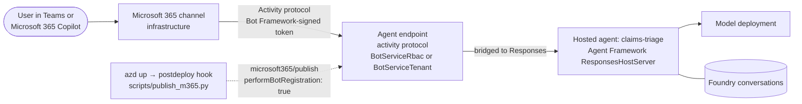

# Architecture

## How the agent reaches Teams and Microsoft 365 Copilot



1. `azd up` provisions the Foundry account, project, and model (the
   `microsoft.foundry` layer) and deploys the hosted agent. The agent speaks only
   the Responses protocol.
2. The agent service's `postdeploy` hook runs `scripts/publish_m365.py`, which
   calls `POST {project}/agents/claims-triage/microsoft365/publish`. Foundry then:
   - registers the agent's own Entra identity and Activity endpoint with Teams
     (`performBotRegistration: true`), so there is no Azure Bot Service resource;
   - turns on the `activity` protocol and a Bot Service authorization scheme on
     the agent endpoint;
   - builds and validates the Teams app package and submits it to the Teams and
     Microsoft 365 Copilot agent stores.
3. A user opens the agent in Teams or Microsoft 365 Copilot. The channel sends
   Activity-protocol messages to the agent endpoint. Foundry validates the signed
   channel token, applies the authorization scheme, and bridges the message to
   the agent's Responses protocol. Foundry keeps the conversation history.

New agent versions reach Teams without republishing: the published app points
at the agent's stable endpoint. Republish (with a higher `TEAMS_APP_VERSION`)
only to change the name, descriptions, or URLs shown in the store.

## Who can use it

| `TEAMS_PUBLISH_SCOPE` | Store listing | Authorization scheme | Who can chat | Admin step |
|---|---|---|---|---|
| `Shared` (default) | **Your agents**, for the publisher; share by link | `BotServiceRbac` | Signed-in users in the project's tenant who have Foundry permissions on the project (for example **Foundry User**) | None |
| `Tenant` | **Built by your org**, for everyone | `BotServiceTenant` | Any signed-in user in the project's tenant | A Microsoft 365 admin approves the request in the [admin center](https://admin.cloud.microsoft/?#/agents/all/requested) |

Guest users can't use the agent in either scope.

## Why not the Foundry Compass approach

Foundry Compass, which this template's requirements come from, publishes the
same kind of agent through an Azure Bot Service resource, an API Management API
that validates the Bot Framework token, and two post-deploy scripts. That design
predates bot registration in the publish API: the API then required a
`botServiceArmId`. Compass's live findings show what that plumbing cost: a
globally unique, immutable `msaAppId` that needed delete-and-recreate logic, a
race between the bot and its Teams channel, and a reply parser that silently
returned empty messages.

With `performBotRegistration: true`, Foundry registers the agent with Teams,
validates the channel token, and enforces the tenant or RBAC check itself, so
none of that is needed for a project with public network access. The
requirements Compass encoded are kept:

| Requirement from Compass | How this template meets it |
|---|---|
| Publishing needs the deployed agent, so it runs after deploy | The agent service's `postdeploy` hook. It is a service hook rather than a project hook, because Compass found extension-driven deploys can skip the project-level hook. |
| The publish API acts on behalf of a signed-in user; a managed identity or service principal gets a bare 502 | The script checks the token type and skips with an explanation instead of failing the deploy. |
| Inbound channel traffic must be authenticated and limited to the tenant | Foundry's `BotServiceRbac` / `BotServiceTenant` schemes, set by the publish call. |
| `Shared` by default; organization-wide only with admin approval | `TEAMS_PUBLISH_SCOPE` defaults to `Shared`. |

For a project with public network access disabled, follow Microsoft's
[REST publishing guide](https://learn.microsoft.com/azure/foundry/agents/how-to/publish-copilot-virtual-network):
it adds `enable_m365_public_endpoint` so only the Activity route is reachable
from Microsoft 365 source ranges.

## What works in each surface

From Microsoft Learn (sources below) and this template's live test:

- **No streaming and no citations.** Published agents reply with the complete
  message.
- **Conversation history is kept by Foundry.** In Teams, send
  `/foundry_new_preview` to start a new conversation; there is no other way to
  reset it. In Microsoft 365 Copilot, start a new chat.
- **File uploads and image generation** work in Teams, not in Microsoft 365
  Copilot. This agent uses neither.
- **Identity.** When a user token is present the platform supports on-behalf-of
  calls to downstream services; otherwise the agent uses its own Entra identity.
  This agent only reads bundled synthetic data.
- **Tool approvals.** See the live validation findings in the README: the
  approval-gated `escalate_claim` tool is the part of this sample that behaves
  differently from the web client.

## Trace content

Verified live on 2026-11-15: with `OTEL_INSTRUMENTATION_GENAI_CAPTURE_MESSAGE_CONTENT=false`,
no span from the agent container carried message content, but the Foundry service's own
`invoke_agent` and `chat` spans (`cloud_RoleName` `responsesapi`, `sdkVersion` `aifoundry-v1.0`)
contained the full `gen_ai.input.messages` and `gen_ai.output.messages`. `ENABLE_SENSITIVE_DATA`
and `AZURE_TRACING_GEN_AI_CONTENT_RECORDING_ENABLED` did not change that.

According to [Foundry tracing and data handling](https://learn.microsoft.com/azure/foundry/observability/concepts/trace-data),
tracing records prompts and model inputs and outputs whenever the project is connected to
Application Insights, and disconnecting Application Insights is the only way to stop it. Control
who can read it instead: grant Log Analytics Reader sparingly, set the Log Analytics tables to
[protected](https://learn.microsoft.com/azure/azure-monitor/logs/protected-tables-configure) so
reading them needs Privileged Monitoring Data Reader, and set retention to what you need.

Check what your project records:

```kusto
dependencies
| where timestamp > ago(1h)
| summarize spans = count(), with_content = countif(isnotempty(customDimensions["gen_ai.input.messages"])) by cloud_RoleName
```

## Sources

Checked on 2026-11-15.

- [Publish agents to Microsoft Copilot and Microsoft Teams](https://learn.microsoft.com/azure/foundry/agents/how-to/publish-copilot) (updated 2026-11-04)
- [Publish agents to Microsoft 365 and Teams by using the REST API](https://learn.microsoft.com/azure/foundry/agents/how-to/publish-copilot-virtual-network) (updated 2026-11-06)
- [Troubleshoot publishing agents to Microsoft Copilot and Microsoft Teams](https://learn.microsoft.com/azure/foundry/agents/how-to/troubleshoot-publish-copilot) (updated 2026-10-23)
- [Hosted agents in Foundry Agent Service](https://learn.microsoft.com/azure/foundry/agents/concepts/hosted-agents) (updated 2026-11-11): Responses is bridged to Activity on publish
