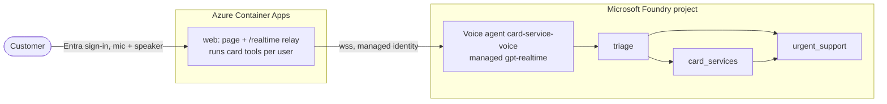

# Voice-first multi-agent customer service

A customer talks to Contoso Bank card services in the browser. A **triage** stage works out why
they called and hands off to a **card services** specialist for routine requests (freeze,
unfreeze, status, replacement), or straight to **urgent support** at the first sign of fraud or
theft. Any change to a card needs the customer to say yes first, and it runs exactly once.

It's built on a Microsoft Foundry **voice agent** (`kind: voice`, preview): one versioned
definition with a service-managed realtime model, a voice, turn detection, and inline stages
that hand off to each other. A small web app relays the call so the browser never holds a
token, and runs the card tools for the signed-in customer. All data is synthetic.

> **Preview.** Foundry voice agents are a preview, gated by subscription and region. Microsoft's
> samples name Sweden Central and France Central; confirm availability for your subscription.

## What this template is for

- Learn how to put a natural voice experience in front of Foundry Agent Service.
- See multi-stage handoffs (triage → specialist → urgent escalation) done by the service.
- Keep consequential actions safe: staged, read back, confirmed, executed once, bound to the
  signed-in user in code.
- Evaluate a voice agent with simulated callers and per-scenario rubrics.

## What this template is not for

It doesn't connect to a real bank or card system, authenticate callers by voice or one-time
passcode, take phone calls (Foundry voice agents support Teams Phone and Twilio separately), keep
call recordings, or run more than one web replica. It isn't a production-ready or multitenant
application, and it has no support SLA.

**Privacy:** the template stores no recordings (`store: false`) and its web app logs no transcripts,
but with Application Insights connected (the default), the voice service's traces contain what the
caller said and what the agent replied. Restrict who can read traces and set retention, or disconnect
Application Insights. See [Telemetry and privacy](docs/architecture.md#telemetry-and-privacy).

Review [Cost planning](docs/cost.md) before provisioning.

## Architecture



| Folder | What it holds |
|---|---|
| `agent/voice-agent.json` | The voice agent: instructions, audio settings, greeting, stages, handoff conditions, and tool schemas. |
| `scripts/publish_voice_agent.py` | Publishes the definition as a new agent version (azd `postprovision` hook). |
| `src/web` | Node web app: static page, `/realtime` relay (`relay.mjs`), and card tools (`tools.mjs`). |
| `infra-foundry`, `infra` | `microsoft.foundry` layer (account, project, evaluation model) and a Bicep layer (Container Apps, registry, identity, RBAC, Entra sign-in with no secret). |
| `evals` | Simulated-caller scenarios with rubrics, and the `azd ai eval` configuration. |

See [Architecture](docs/architecture.md) for the request flow, the research behind the design,
and the security model.

## Deploy

Required tools: Azure CLI, Azure Developer CLI (`azd`) 1.32 or later, and Python 3 on the `PATH`
(for the post-provision hook). The deploying identity needs Owner (or Contributor and User Access
Administrator) on the subscription, permission to create Microsoft Entra app registrations, and
quota for 30K TPM of `gpt-5-mini` GlobalStandard (used only for evaluation).

```bash
azd extension install azure.ai.projects
azd extension install azure.ai.evaluations
az login
azd auth login
azd env new <environment-name> --subscription <subscription-id> --location swedencentral
azd env set AZURE_PRINCIPAL_ID $(az ad signed-in-user show --query id -o tsv)
azd up
```

`azd up` provisions the Foundry project and the web app, publishes the voice agent, deploys the
web app, and registers the evaluation. Open the `WEB_URL` it prints and sign in.

The managed realtime model identifier depends on what your project is enabled for. The hook tries
`gpt-realtime-2.1`, then `gpt-realtime-1.5`, then `gpt-realtime-2.1-mini`. To choose one, run
`azd env set VOICE_AGENT_MODEL <identifier>` and `azd provision` again.

## Try it

Select **Start call**, allow the microphone, and speak:

1. "I'd like to freeze my debit card ending 4821. I left it at home." The call moves to **Card
   services**, which reads back the freeze and asks for a yes. Nothing has changed yet.
2. "Yes, go ahead." The card shows as frozen under **Your cards**, with a reference under
   **Actions**.
3. Start a new call and say "My wallet was stolen and there are charges I don't recognise." The
   call moves straight to **Urgent support**, which offers to block and replace the card and
   arrange a callback.

You can also type into the box under the transcript. **Latency** shows time to first audio after
you stop speaking.

## Evaluate

Voice agents are evaluated on transcripts with Foundry's standard evaluators. This template wires up
two of the three documented workflows in `evals/azure.eval.yaml`, both scored with
`builtin.task_completion`, `builtin.customer_satisfaction`, and `card-service-voice-rubric`. That
rubric evaluator is defined in the same file, with weighted dimensions for urgent routing, routine
routing, confirmation before changes, sensitive data, scope, outcome, and voice style.

| Eval | What it scores | Run it |
|---|---|---|
| `card-service-voice-traces` | **Real calls** (spoken or typed) from the project's Application Insights traces, including the card tools the relay ran. Use it for routing, confirmation, and tool behavior. | `azd ai eval run start --eval card-service-voice-traces` |
| `card-service-voice-simulation` | **Simulated callers** from `evals/caller-scenarios.jsonl` (seven synthetic scenarios), spoken to the voice agent with an Azure neural voice and a telephone-line effect. | `python evals/run_voice_simulation.py` |

`azd up` (or `azd deploy card-service-voice-evals`) publishes the dataset, the rubric, and both evals.
The Bicep layer gives the project's managed identity the read access trace evaluation needs:
Reader, Log Analytics Reader, and Privileged Monitoring Data Reader. Role assignments can take a few
minutes to apply.

Know what each one can't see:

- **Simulation runs without the relay,** so the card tools (native functions the relay executes)
  never return. Simulated calls show routing, tone, safety, and scope, but tool-dependent scenarios
  can't complete. Use the traces eval for those.
- **Voice simulation needs a `voice_model`,** which the azd eval configuration (`azure.ai.evaluations`
  1.0.0-beta.2) can't express, so `evals/run_voice_simulation.py` starts that run with the SDK
  (`pip install "azure-ai-projects>=2.11.0" azure-identity pyyaml`).
- **Neither judges audio:** pronunciation, audio quality, and interruption timing need listening tests.

Per-conversation results: `azd ai eval run output list --eval <eval-id> --run <run-id>`.

## Customize

- **Stages and routing:** edit `agent/voice-agent.json` (`subagent_config`). Every function tool you
  add there must be implemented in `src/web/tools.mjs`; `tests/test_contracts.py` checks this.
- **Your own systems:** replace the synthetic data in `tools.mjs` with calls to your APIs, keeping
  the stage-then-confirm pattern.
- **Language and voice:** set `audio.output.voice` (the default multilingual voice replies in the
  caller's language) and the transcription language settings.

## Clean up

```bash
PROJECT=$(azd env get-value AZURE_AI_PROJECT_NAME)
APP_ID=$(azd env get-value WEB_APP_REGISTRATION_CLIENT_ID)
azd down --purge
az ad app delete --id "$APP_ID"
```

`azd down` doesn't remove the Microsoft Entra agent identities that Foundry creates for agents
(display names end in `AgentIdentity`, tagged with the project name). After the resource group is
gone, list and delete the ones for this project:

```bash
az rest --method get --headers ConsistencyLevel=eventual \
  --url "https://graph.microsoft.com/beta/servicePrincipals?\$filter=endswith(displayName,'AgentIdentity')&\$count=true&\$select=id,displayName,tags&\$top=200" \
  --query "value[?contains(tags, 'projectName:$PROJECT')].[id, displayName]" -o tsv
az rest --method delete --url "https://graph.microsoft.com/beta/servicePrincipals/<id>"   # for each id listed
```

## Validation status

Validated live on 2026-11-15 in Sweden Central (azd 1.37.3, `azure.ai.projects` 1.1.0,
`azure-ai-projects` 2.11.0, voice agent model `gpt-realtime-2.1`), then torn down.

- **Spoken calls in Chromium** (synthesized caller audio as the microphone, through the relay):
  - routine freeze: the request was transcribed exactly, routed to card services, read back, and
    executed **once** after a spoken "yes";
  - stolen wallet: routed straight to urgent support, and block-and-replace was executed **once**
    after a spoken "yes".
  - Time to first audio after the caller stopped speaking, over 27 turns: p50 1,454 ms, p90
    1,899 ms.
- **Typed calls through the relay:**
  - routine and urgent calls each executed exactly one change;
  - a declined change executed none;
  - a repeat request on an already-frozen card was refused.
- **Deployed app with its own managed identity** (run inside the container): an urgent call routed,
  confirmed, and executed once.
- **Sign-in:** the public endpoint returns 401 for the page, the API, and the `/realtime` WebSocket
  without sign-in, including with a spoofed principal header.
- **Evaluation:**
  - traces eval on 30 real calls (27 scored): rubric 96.3% passed, customer satisfaction 100%
    (mean 4.0), task completion 63% (the misses are calls where the caller's "yes" never arrived);
  - simulation: the conversation layer only (see [Evaluate](#evaluate)).

**Known issue in automated testing:** with Chromium's file-based fake microphone, about one run in
three stopped delivering microphone audio about 13 seconds into the call, so later turns weren't
heard. Changing playback, audio contexts, and echo cancellation didn't affect it. It hasn't been
checked with a real microphone, so try multi-turn calls in a real browser before relying on them.
